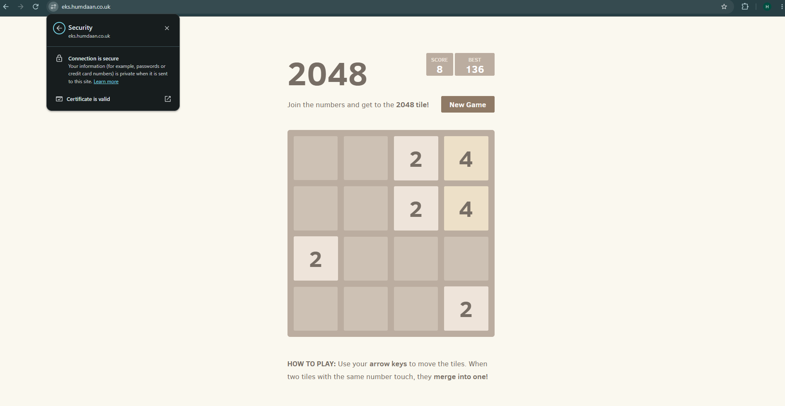
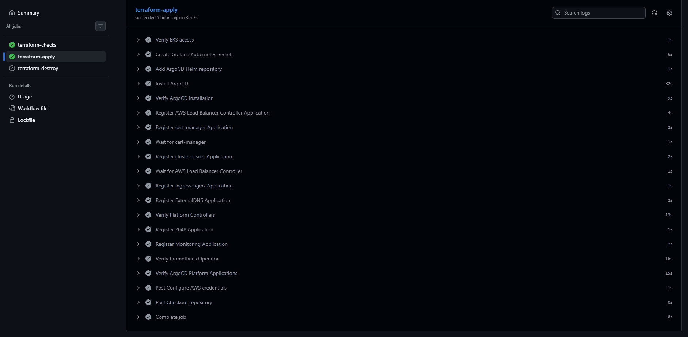
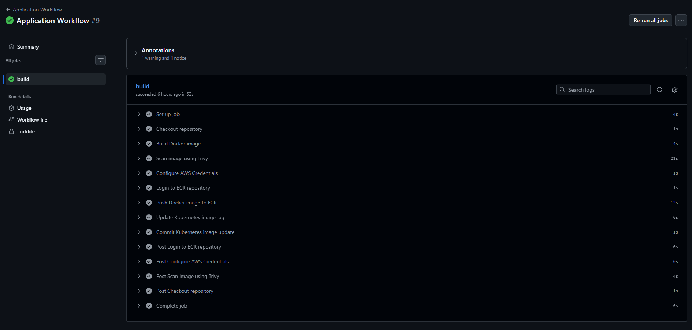
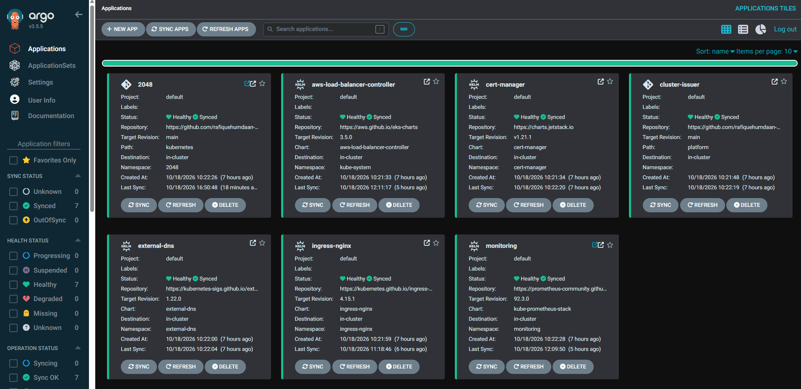
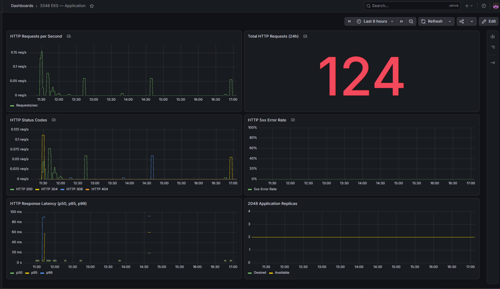
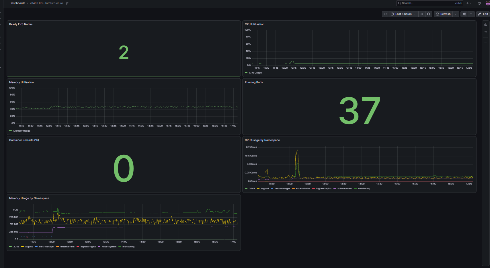

# 2048 on Amazon EKS

I built this project to take the 2048 web game from a Docker container to a working deployment on AWS. The project focuses on the infrastructure and how I deploy, update, and monitor the application.

Terraform provisions the AWS environment, GitHub Actions runs the infrastructure and application workflows, and ArgoCD keeps the Kubernetes configuration in sync with Git.

## The application

When the environment is running, the game is available at [eks.humdaan.co.uk](https://eks.humdaan.co.uk) over HTTPS. I tear down the environment between uses to keep AWS costs down, so the site may be offline.

## How it fits together

The application runs on Amazon EKS in the AWS London region (eu-west-2), with Docker images stored in Amazon ECR. The cluster uses two managed node groups, one in each Availability Zone, with worker nodes in private subnets. The 2048 application and selected platform components use topology spread constraints to distribute replicas across the two zones.

Cloudflare delegates the application's DNS zone to Route 53, where ExternalDNS manages the application record. An internet-facing AWS Network Load Balancer forwards traffic to Traefik, which routes requests to the 2048 service. cert-manager obtains the HTTPS certificate from Let's Encrypt using DNS validation.

### AWS and Kubernetes architecture

## Deploying changes

I split the automation into two workflows, one for the infrastructure and one for the application.

The [Terraform workflow](.github/workflows/terraform.yaml) checks formatting, validates the configuration, and runs TFLint, YAML linting, and Checkov. Relevant pull requests run the checks and a Terraform plan. Apply and destroy are triggered manually. Before the first run, I apply a separate Terraform bootstrap locally to set up the remote state backend and the AWS role used by GitHub Actions.

During apply, the workflow provisions the infrastructure, installs ArgoCD, and registers the platform applications through an App-of-Apps setup. During destroy, it removes Kubernetes-managed resources, including the Traefik load balancer, before Terraform tears down the AWS infrastructure.

The [application workflow](.github/workflows/application.yaml) builds the Docker image, scans it with Trivy, and pushes it to ECR with the Git commit SHA as the image tag. The workflow commits the updated image reference in the Kubernetes Deployment manifest. ArgoCD syncs the change to EKS, and the workflow verifies the Kubernetes rollout.

I use ArgoCD to check the sync and health status of the application and platform components.

The [destroy pipeline screenshot](documentation/Screenshots/terraform-destroy-pipeline.png) shows the teardown process. The [application resource tree screenshot](documentation/Screenshots/2048-application-resource-tree.png) shows the Kubernetes resources managed by ArgoCD for 2048.

## Monitoring

I use Prometheus to collect metrics and Grafana to view them. The dashboards below show application activity and cluster resource usage.

### Application metrics

### Cluster metrics

## Further documentation

- [System design](documentation/system-design.md) covers the AWS infrastructure, Kubernetes components, and design decisions.
- [Security](documentation/security-overview.md) covers IAM, network security, HTTPS, secrets, and how Checkov and Trivy report findings.
- [Networking](documentation/networking.md) explains the VPC layout, DNS, load balancing, and how requests reach the application.
- [CI/CD](documentation/cicd-overview.md) walks through the two workflows, the ArgoCD setup, and the deployment lifecycle.
- [Future improvements](documentation/future-improvements.md) describes changes I would make in a future iteration.