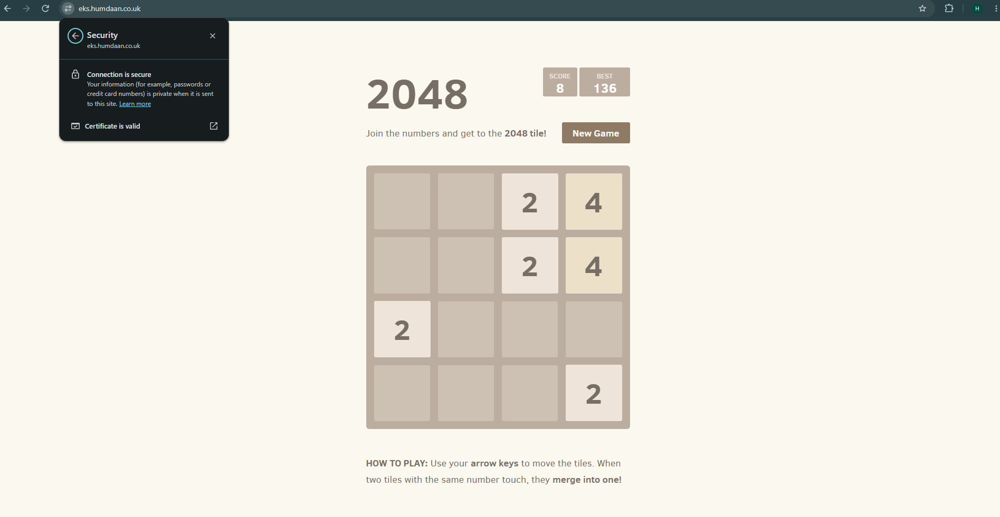
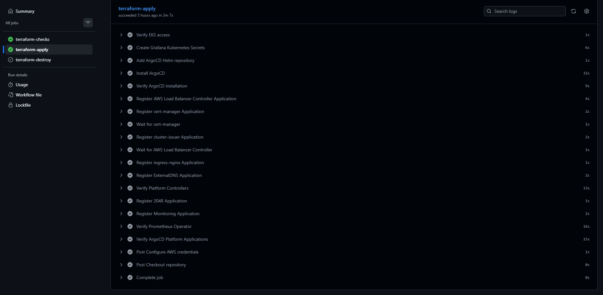
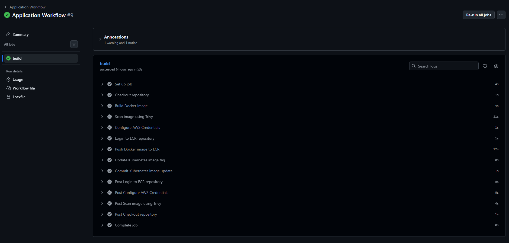
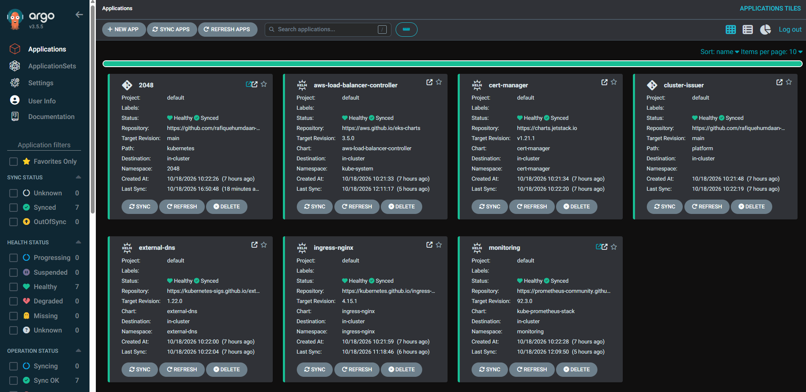
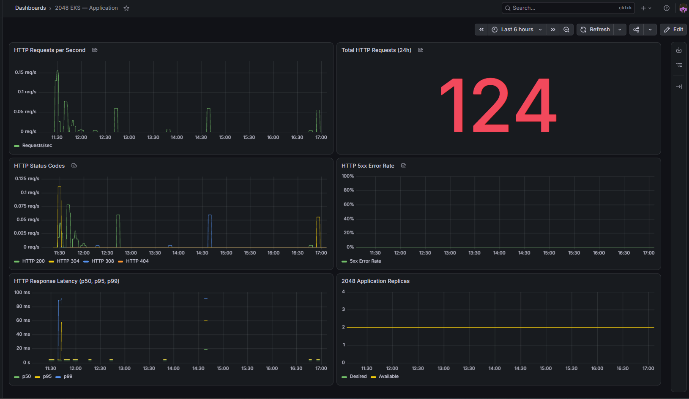
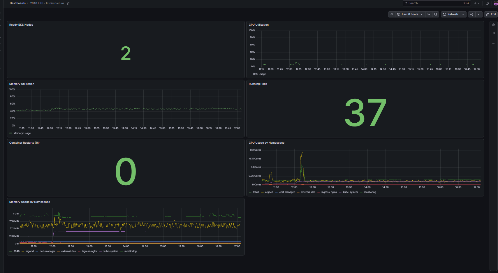

# 2048 on Amazon EKS

Welcome to my EKS-2048 Project. I built the below project from scratch, taking an application from a Docker container to a working deployment on AWS. The main focus for this project is not the application but the infrastructure, Kubernetes, and deploying and updating the application.

Terraform provisions the AWS environment, GitHub Actions runs the pipelines, and ArgoCD keeps the application and configuration in my Kubernetes environment in sync with my GitHub repository.

## The application

When the environment is running, the game is available at [eks.humdaan.co.uk](https://eks.humdaan.co.uk) over HTTPS. I destroy the environment when I am not using it to keep AWS costs down, so the site may be offline.

## How it fits together

The application runs on Amazon EKS, with Docker images stored in ECR. I use Helm to manage the Kubernetes components, Traefik to route traffic, and cert-manager for HTTPS certificates. The cluster has two managed node groups, one in each Availability Zone, with the 2048 application and several platform components running replicas across both zones.

### AWS and Kubernetes architecture

## Deploying changes

I split the automation into two workflows: one for the infrastructure and one for the application.

The [Terraform workflow](.github/workflows/terraform.yaml) runs infrastructure checks and Checkov scans. It supports plan, apply, and destroy operations, and sets up ArgoCD when the environment is created. The Terraform workflow must run after the bootstrap is applied first using a local Terraform apply command.

The [application workflow](.github/workflows/application.yaml) builds the Docker image, scans it with Trivy, pushes it to ECR, and updates the image tag in Git. ArgoCD picks up that change and syncs the deployment with the repository.

ArgoCD also gives me a view of the application and platform components running in the cluster.

The [destroy pipeline screenshot](documentation/Screenshots/terraform-destroy-pipeline.png) and [application resource tree screenshot](documentation/Screenshots/2048-application-resource-tree.png) show the teardown process and the Kubernetes resources in more detail.

## Monitoring

I use Prometheus and Grafana to monitor the application and the EKS environment. These dashboards show the application metrics and the infrastructure behind it.

### Application metrics

### Cluster metrics

## Further documentation

I have added the files below for anyone interested in reading more in-depth documentation:

- [System design](documentation/system-design.md): AWS infrastructure, EKS, Kubernetes components and design decisions.
- [Security](documentation/security-overview.md): IAM, network security, HTTPS, secrets and security scanning.
- [Networking](documentation/networking.md): VPC layout, DNS, load balancing and the route requests take to the application.
- [CI/CD](documentation/cicd-overview.md): Terraform and application workflows, GitOps and the deployment lifecycle.
- [Future improvements](documentation/future-improvements.md): Outlines suggestions for what could be added to improve the quality of the Infrastructure.
