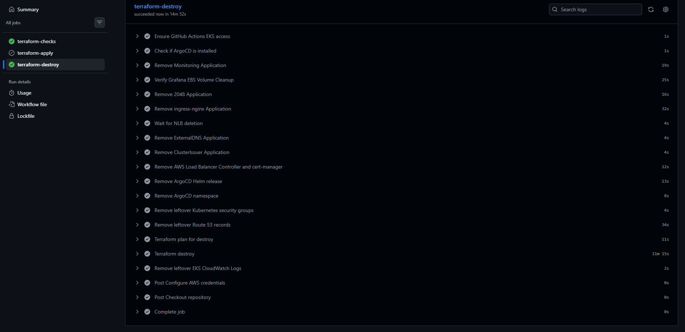

# CI/CD Overview

The project uses two GitHub Actions workflows. The first manages AWS infrastructure and bootstraps the Kubernetes platform. The second builds and delivers changes to the 2048 application. ArgoCD handles the final deployment into EKS.

## Pipeline 1: Infrastructure

[View Terraform workflow](../.github/workflows/terraform.yaml)

The Terraform workflow validates the infrastructure configuration and provides manual plan, apply and destroy actions.

| Stage | What it does |
|---|---|
| Checks | Runs Checkov, Terraform formatting and validation |
| Plan | Reviews proposed infrastructure changes |
| Apply | Creates or updates AWS resources using Terraform |
| Platform bootstrap | Installs ArgoCD and registers the Kubernetes platform components |
| Verification | Waits for the relevant controllers and monitoring components to become healthy |
| Destroy | Removes ArgoCD-managed resources before tearing down AWS infrastructure |

The workflow stores its Terraform state in an encrypted, versioned S3 bucket with locking enabled. GitHub Actions accesses AWS using OIDC rather than stored access keys.

### Infrastructure workflow results

## Pipeline 2: Application

[View application workflow](../.github/workflows/application.yaml)

This workflow handles application changes without having to rebuild the infrastructure.

1. Build the 2048 Docker image.
2. Scan the image with Trivy.
3. Authenticate to AWS and push the image to ECR using the Git commit SHA as its tag.
4. Update the image reference in the Kubernetes Deployment manifest and commit the change back to Git.
5. Wait for ArgoCD to reconcile the updated manifest and verify that the Deployment is running and healthy.

It supports a manual scan-only action as well as deployment.

### Application workflow result

## ArgoCD and GitOps

ArgoCD watches the Git repository as the source of truth for the application manifests and platform configuration. When the application pipeline commits a new image tag, ArgoCD detects the change and applies it to EKS.

This keeps image building and image deployment separate. The pipeline publishes the image and updates Git, while ArgoCD brings the cluster into line with that version. Automatic sync, pruning and self-healing are enabled for the 2048 application.

## Deployment and teardown

The workflows were tested with successful infrastructure apply and destroy runs, and the application pipeline was also tested successfully. The destroy workflow includes cleanup for Kubernetes-managed load balancers, Grafana storage and related resources before Terraform removes the infrastructure.

The separation between the two pipelines means the cluster can stay in place while application versions change. It also allows the AWS environment to be destroyed between study sessions to control costs.

For the overall architecture, see [System Design](system-design.md). Security checks and credentials are covered in the [Security Overview](security-overview.md).
