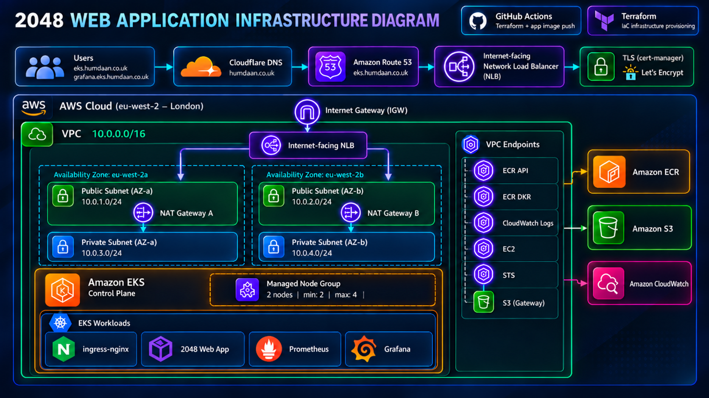
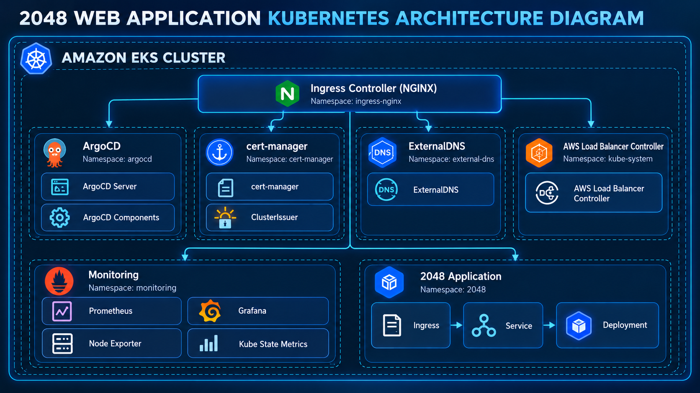
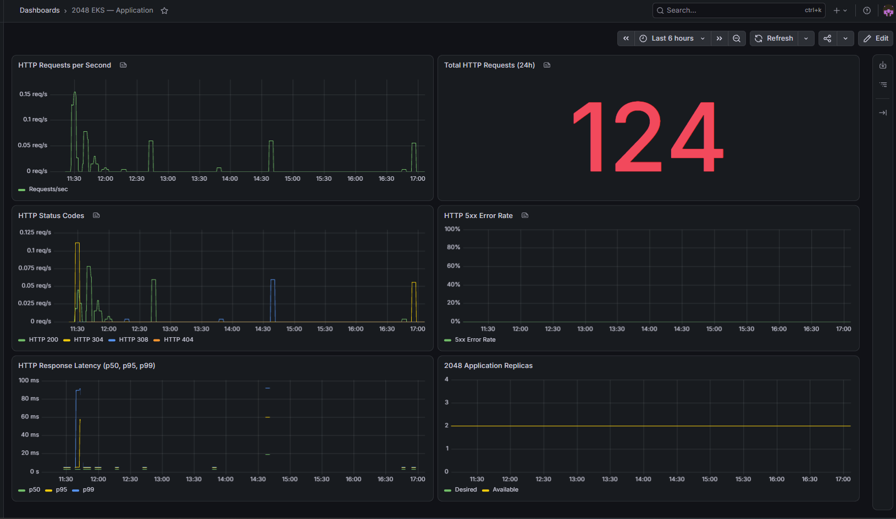
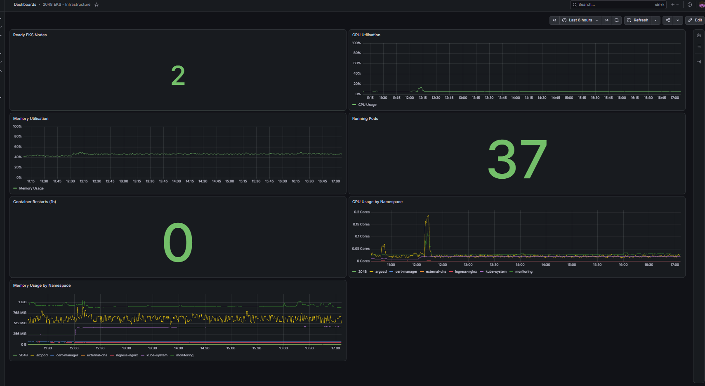

# 1. Architecture Overview

This project involves deploying the 2048 web application on Amazon EKS, with the underlying AWS infrastructure provisioned using Terraform. The aim was to build an environment that could be deployed, updated and destroyed through automation rather than managed manually.

The infrastructure runs in the AWS London region (eu-west-2), across two Availability Zones. Public subnets accommodate the NAT Gateways and internet-facing load balancer, while private subnets host the EKS worker nodes.

## AWS Infrastructure

The application is accessible at https://eks.humdaan.co.uk when the environment is running.

Cloudflare delegates the application's DNS zone to Amazon Route 53. Incoming traffic reaches an AWS Network Load Balancer, which forwards requests to the NGINX Ingress Controller inside EKS. NGINX then routes traffic to the application through a Kubernetes Service.

HTTPS certificates are managed automatically by cert-manager using Let's Encrypt.

## Kubernetes Architecture

Inside the cluster, the 2048 application runs as a Kubernetes Deployment with two replicas, exposed internally through a ClusterIP Service.

Several other components are deployed to support the application:

- ArgoCD manages deployments and keeps Kubernetes resources in sync with Git.
- Helm is used to install and configure the platform components.
- NGINX Ingress routes incoming requests to the appropriate Kubernetes services.
- cert-manager manages TLS certificates and their renewal.
- ExternalDNS manages DNS records in Amazon Route 53.
- Prometheus collects metrics from Kubernetes and its workloads.
- Grafana provides dashboards for monitoring the application and infrastructure.

AWS ECR stores the application's container images, while CloudWatch collects logs from the EKS control plane.

The following sections explain the infrastructure components and why they were included. Networking, security and CI/CD are covered in separate documents.

---

# 2. AWS Infrastructure

The AWS infrastructure is provisioned using Terraform, with resources organised into separate modules to keep the configuration manageable.

The environment runs in the London region (eu-west-2) and uses a combination of managed AWS services, private networking and container infrastructure.

## Virtual Private Cloud (VPC)

The project uses a dedicated VPC with the CIDR range 10.0.0.0/16, divided into four subnets across two Availability Zones.

| Subnet | CIDR | Availability Zone | Purpose |
|---|---|---|---|
| Public 1 | 10.0.1.0/24 | eu-west-2a | NAT Gateway and public load balancing |
| Public 2 | 10.0.2.0/24 | eu-west-2b | NAT Gateway and public load balancing |
| Private 1 | 10.0.3.0/24 | eu-west-2a | EKS worker nodes |
| Private 2 | 10.0.4.0/24 | eu-west-2b | EKS worker nodes |

Worker nodes are placed in private subnets so they are not directly accessible from the public internet.

An Internet Gateway provides internet connectivity for the public subnets. Two NAT Gateways, one in each Availability Zone, allow resources in the private subnets to initiate outbound connections.

### VPC Endpoints

VPC endpoints allow the worker nodes to communicate privately with certain AWS services without routing traffic through the NAT Gateways.

The following endpoints are configured:

| Service | Endpoint Type | Purpose |
|---|---|---|
| ECR API | Interface | Access container registry APIs |
| ECR Docker | Interface | Pull container images |
| S3 | Gateway | Access S3 privately |
| CloudWatch Logs | Interface | Communicate with CloudWatch Logs |
| EC2 | Interface | Access EC2 APIs |
| STS | Interface | Access AWS token services |

These endpoints reduce reliance on NAT Gateways when communicating with supported AWS services.

## Amazon EKS

Amazon EKS provides the managed Kubernetes control plane, removing the need to maintain the control-plane servers ourselves.

The cluster uses a managed node group spread across two private subnets.

| Configuration | Value |
|---|---|
| Cluster Name | 2048-eks-cluster |
| Instance Type | c7i-flex.large |
| Desired Nodes | 2 |
| Minimum Nodes | 2 |
| Maximum Nodes | 4 |
| Capacity Type | On-Demand |

The EC2 worker nodes provide the compute resources for the application and supporting Kubernetes components.

Managed node groups simplify the provisioning and maintenance of these nodes, while the scaling configuration allows the group to operate between two and four nodes when its desired capacity is adjusted.

## Amazon ECR

Amazon Elastic Container Registry stores the Docker images used by the 2048 application.

The application pipeline builds the image, scans it with Trivy and pushes it to ECR using the Git commit SHA as the image tag.

The repository uses immutable image tags and enables scanning on push. This makes it easier to identify the exact application version being deployed.

## Terraform Remote State

Terraform state is stored remotely in an S3 bucket rather than on the local machine.

The bucket has versioning and encryption enabled, while the Terraform backend uses state locking to prevent simultaneous modifications.

This allows GitHub Actions to access the same infrastructure state across different workflow runs and reduces the risk of conflicting changes.

## Logging and Storage

Several AWS services are used for storing application images, infrastructure state, logs and monitoring data.

| Service | Purpose |
|---|---|
| CloudWatch Logs | Stores EKS control-plane logs |
| Amazon EBS | Provides persistent storage for Grafana |
| Amazon S3 | Stores Terraform state |
| Amazon ECR | Stores container images |

Grafana uses a 5 GiB EBS-backed persistent volume, allowing its stored data to survive Pod restarts and rescheduling.

Prometheus uses temporary storage with a seven-day retention setting. Its stored metrics are not persistent and will be lost when the relevant storage is removed.

## Design Decisions

A few considerations influenced how the infrastructure was built:

- Private subnets keep the EKS worker nodes away from direct public internet exposure.
- Using two Availability Zones reduces dependence on a single zone.
- Managed AWS services reduce the amount of infrastructure that needs to be maintained manually.
- Terraform allows the environment to be recreated consistently.
- VPC endpoints provide private connectivity to frequently used AWS services.
- The destroy workflow helps control costs by removing infrastructure when it is no longer needed.

The overall design is intended to demonstrate production-style infrastructure practices while remaining manageable and cost-conscious for a personal DevOps project.

---

# 3. Kubernetes Architecture

EKS runs the application and the services needed to expose, manage and monitor it. Kubernetes resources are kept in separate namespaces so the application is not mixed in with the platform components.

## Application Workloads

The 2048 application runs in the 2048 namespace. Its main resources are:

| Resource | Purpose |
|---|---|
| Deployment | Runs two copies of the web application |
| ClusterIP Service | Gives the Pods a stable internal endpoint on port 80 |
| Ingress | Routes requests for eks.humdaan.co.uk to the Service |
| TLS certificate | Enables HTTPS for the application hostname |

The Deployment has startup, readiness and liveness probes. These help Kubernetes decide when a container is ready to receive traffic and when it should be restarted. CPU and memory requests and limits are also defined so the scheduler has a clearer picture of the application's resource needs.

Two replicas provide some redundancy if a Pod fails.

## Platform Components

The cluster includes the following supporting components:

| Component | Namespace | Purpose |
|---|---|---|
| NGINX Ingress Controller | ingress-nginx | Receives traffic from the AWS Network Load Balancer and routes it to services |
| AWS Load Balancer Controller | kube-system | Manages the AWS load balancer resources used by Kubernetes |
| cert-manager | cert-manager | Issues and renews TLS certificates using Let's Encrypt |
| ExternalDNS | external-dns | Updates Route 53 records based on Kubernetes resources |
| ArgoCD | argocd | Keeps the cluster aligned with the configuration stored in Git |
| Prometheus and Grafana | monitoring | Collect and display monitoring data |

These components are installed using Helm charts and managed as ArgoCD Applications. Separating them from the 2048 namespace makes the cluster easier to organise and troubleshoot.

---

# 4. Infrastructure and Configuration Management

The project uses Terraform, Helm and ArgoCD for different parts of the deployment. Each tool has a specific role.

| Tool | Responsibility |
|---|---|
| Terraform | Creates and removes AWS infrastructure, including the VPC, EKS, ECR and DNS resources |
| Helm | Defines how Kubernetes platform components are installed and configured |
| ArgoCD | Applies the desired Kubernetes configuration from Git and detects drift |

Terraform is split into modules so networking, EKS, IAM-related resources and other AWS services can be managed separately. The state is stored remotely in S3, making it available to the infrastructure workflow.

Once EKS exists, the infrastructure workflow bootstraps ArgoCD and registers the platform Applications. ArgoCD then manages the 2048 manifests and the platform Helm releases. Automated syncing and self-healing allow it to reconcile changes made in Git or unexpected changes made inside the cluster.

The application deployment follows a similar approach. GitHub Actions builds the container, pushes it to ECR and updates the image tag in the Kubernetes manifest. ArgoCD picks up that Git change and rolls out the new image.

This separation was intentional. Terraform handles the cloud resources, while ArgoCD is responsible for the ongoing state of Kubernetes. The details of both GitHub Actions workflows are covered in the CI/CD guide.

---

# 5. Monitoring and Observability

Monitoring is deployed as part of the cluster rather than installed manually after the application is running. The project uses the kube-prometheus-stack Helm chart, managed through ArgoCD.

| Component | Purpose |
|---|---|
| Prometheus | Collects and stores metrics |
| Prometheus Operator | Manages Prometheus resources within Kubernetes |
| Grafana | Displays metrics through dashboards |
| Node Exporter | Exposes worker-node metrics |
| kube-state-metrics | Exposes information about Kubernetes resources |
| Alertmanager | Handles alerts generated by Prometheus rules |

Prometheus is configured with seven-day retention and temporary storage. Grafana uses a persistent EBS volume to retain its stored data across Pod restarts. The dashboards provide a way to check both the 2048 application and the EKS environment.

### Monitoring Dashboards

Keeping monitoring under ArgoCD makes it easier to recreate the monitoring stack alongside the rest of the environment.

---

# 6. Availability, Scalability and Cost

The project is designed to be repeatable and reasonably resilient without keeping an expensive environment running all the time.

| Decision | Reason |
|---|---|
| Two Availability Zones | Avoids putting all network and worker-node resources in one zone |
| Two NAT Gateways | Gives each private subnet outbound access through a NAT Gateway in its own zone |
| Private managed nodes | Keeps worker nodes away from direct internet exposure |
| Two application replicas | Allows the application to continue serving traffic if one Pod fails, provided a healthy replica remains |
| Node group minimum 2, maximum 4 | Sets the allowed node count range |
| Terraform destroy workflow | Removes infrastructure when it is not needed, reducing ongoing AWS costs |

The node group is configured with two desired nodes. Its minimum and maximum values define capacity bounds, but those settings alone do not automatically scale the node group based on workload demand.

There are also deliberate trade-offs. Two NAT Gateways and multiple VPC endpoints improve connectivity options but add cost. Prometheus metrics are stored temporarily, so they are not retained when its storage is removed. A full infrastructure destroy also removes the cluster and its attached resources, including Grafana's persistent volume through the configured cleanup process.

This is a portfolio environment built to demonstrate production-style practices.

---

# 7. Related Documentation

This document covers the overall structure of the system and the main design choices. More detail is available in the following guides:

| Guide | What it covers |
|---|---|
| [Security Overview](security-overview.md) | Identity and access, network controls, image scanning, TLS and Kubernetes security measures |
| [Networking and User Request Flow](networking.md) | DNS delegation, load balancing, ingress routing, NAT Gateways and VPC endpoints |
| [CI/CD Overview](cicd-overview.md) | The Terraform and application pipelines, GitHub Actions, ECR and ArgoCD deployment flow |

For a shorter introduction and links to the main project screenshots, see the [project README](../README.md).
